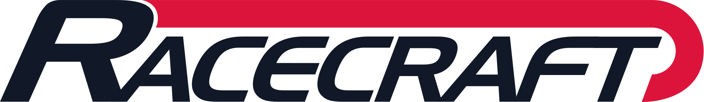

  <picture>
    <source media="(prefers-color-scheme: dark)" srcset="./assets/racecraft-logo-light.svg" />
    <source media="(prefers-color-scheme: light)" srcset="./assets/racecraft-logo.svg" />
    
  </picture>

<strong>Building agent tools in the open, so people stay in charge of their AI agents.</strong>

Racecraft Lab is where I build the tools I need to finish GTO90, a music-reactive racing game that got too big for one person. AI agents now write code faster than I can check it. The tools here are how I keep up with them.

## What's here

- **[racecraft-plugins-public](https://github.com/racecraft-lab/racecraft-plugins-public)**: open-source plugins for Claude Code and Codex. SpecKit Pro turns a spec into reviewed, tested agent work. typesafe-jev gives agents a decision model they can call for typed judgments.
- **[splash-evals](https://github.com/racecraft-lab/splash-evals)**: local evaluations of Splash models against dated frontier results.

## What's next

**Paddock**: a control room for AI agents, where you're the race engineer. It's being designed now and will be open source. There's nothing to install yet.

## Follow along

- LinkedIn: [linkedin.com/in/fgabelmannjr](https://www.linkedin.com/in/fgabelmannjr)
- X: [@fgabelmannjr](https://x.com/fgabelmannjr)
